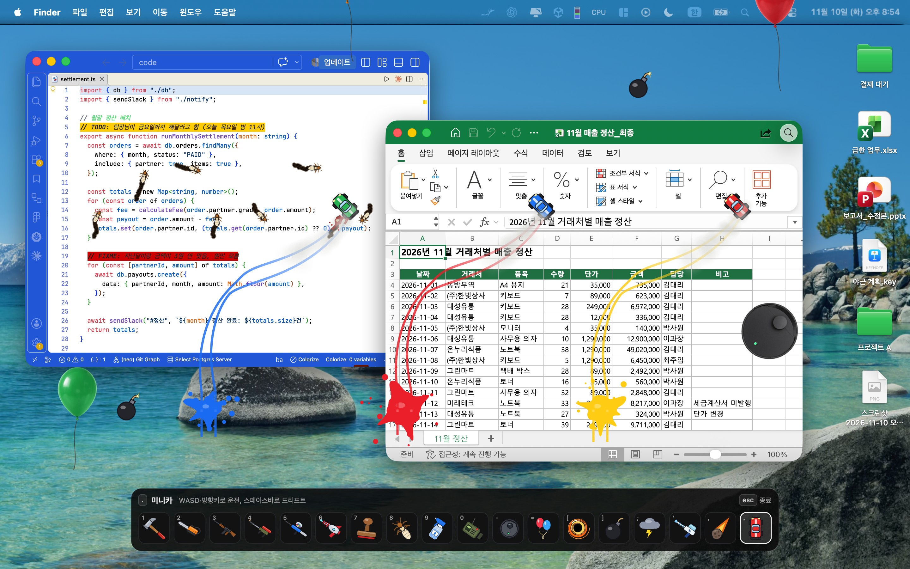

# 바탕화면 부수기 / Desktop Destroyer

## 한국어

바탕화면을 마음껏 부수고 어지르는 macOS 게임입니다. 화면 위의 투명한 놀이용 막에만 효과를 그려 실제 파일과 다른 앱 창은 그대로 둡니다.

망치, 전기톱, 기관총, 화염방사기, 물감방사기, 광선포, 도장, 흰개미, 세척제, 공습, 로봇청소기, 풍선, 블랙홀, 폭탄, 낙뢰, 냉동총, 운석, 미니카까지 18가지 도구를 지원합니다.

- 클릭하거나 끌어서 선택한 도구를 씁니다.
- 1~9, 0, -, =, [, ], ;, ', 쉼표, 마침표 또는 마우스 휠, 오른쪽 클릭, 아래 도구 막대로 도구를 고릅니다.
- 도구 단축키를 누른 채로 쓰면 반복 작동합니다.
- 미니카는 클릭해서 놓은 뒤 WASD나 방향키로 몰고, 스페이스바를 누르면 드리프트합니다.
- 다른 글자나 기호 키를 누르면 해당 키캡이 날아옵니다.
- 블랙홀은 마우스 버튼을 누르고 있다가 놓으면 됩니다.
- ESC 또는 Command-Q로 종료합니다. Command-Tab으로 다른 앱에 가면 놀이용 막이 숨겨집니다.

한국어와 영어가 Mac의 언어 설정에 맞춰 표시됩니다. macOS 14 이상에서 사용할 수 있으며 화면 기록, 손쉬운 사용, 마이크, 카메라 권한이 필요하지 않습니다.

문의는 [Issues](https://github.com/kimchulyeon/desktopdestroyerterms/issues)에 남겨 주세요. 개인정보 처리방침은 [PRIVACY.md](https://github.com/kimchulyeon/desktopdestroyerterms/blob/main/PRIVACY.md)에서 확인할 수 있습니다.

## English

Desktop Destroyer is a macOS desktop toy with 18 tools. All effects live in the app's own transparent play layer, leaving your files and other apps untouched.

Try the Hammer, Chainsaw, Machine Gun, Flamethrower, Paint Sprayer, Laser Cannon, Stamp, Termites, Cleaner, Airstrike, Robot Vacuum, Balloon, Black Hole, Bomb, Lightning, Freeze Gun, Meteor and Mini Car.

- Click or drag to use the selected tool.
- Choose a tool with 1-9, 0, -, =, [, ], ;, ', comma and period, the scroll wheel, right-click, or the bottom toolbar.
- Hold a tool's shortcut key to repeat it.
- Place a mini car with a click, drive it with WASD or the arrow keys and hold Space to drift.
- Other letter and symbol keys launch their keycaps into the play layer.
- With Black Hole selected, hold the mouse button and release it to make it burst.
- Press Esc or Command-Q to quit. Command-Tab hides the play layer while you use another app.

English and Korean follow your Mac's language preferences. Requires macOS 14 or later. No screen recording, accessibility, microphone or camera permission is needed.

For help, open an [issue](https://github.com/kimchulyeon/desktopdestroyerterms/issues). Read the bilingual [Privacy Policy](https://github.com/kimchulyeon/desktopdestroyerterms/blob/main/PRIVACY.md) for details about privacy.
