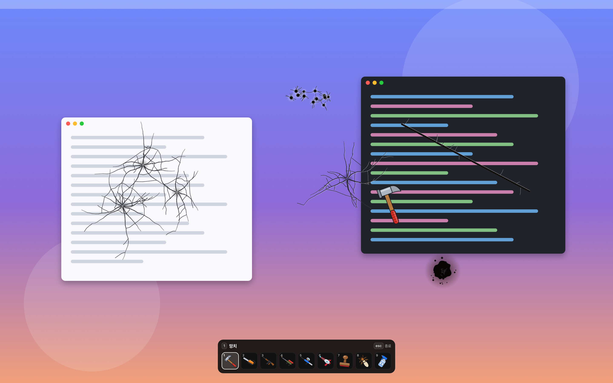

# 바탕화면 부수기

바탕화면을 마음껏 부수는 macOS 게임입니다. 화면 위에 투명한 막을 덮고 그 위에만 흔적을 남기기 때문에 실제 파일이나 창은 건드리지 않습니다.

## 조작

- 클릭하거나 끌어서 고른 도구를 씁니다
- 숫자 1~9, 마우스 휠, 오른쪽 클릭, 아래 도구 막대로 도구를 바꿉니다
- ESC 를 누르면 끝납니다

## 문의

궁금한 점이나 문제는 [Issues](https://github.com/kimchulyeon/desktopdestroyerterms/issues) 에 남겨 주세요.

## 개인정보 처리방침

[개인정보 처리방침](PRIVACY.md)
